# Work instruction (draft): processing GPS data with the BSW 5.4 console

**Draft, 5 November 2026. Not yet reviewed by the processing team.** Checked
against `main` after pull request 346, and against the console as deployed on
gps3 that day.

This is a companion to the October 2025 work instruction for BSW 5.2
(`docs/bern52/Work_Instruction_ao20251030.docx`, called "the 5.2 work
instruction" below). It keeps that document's section numbers, so a step can be
looked up in both. For each step it says what you do instead when the
processing runs on gps3 with Bernese 5.4 and you follow it in the Bernese
processing console (`services/bsw-console`).

It describes the console as it is today, including what is not built yet. Where
a step still has to be done on gps3 from the command line, it says so and names
who does it.

**The screenshots use made-up data**: synthetic stations (`SYN1`, `REF0`), days and
run records, signed in as `demo`. They show what each page looks like, not any real
result. There are two exceptions: the protocol file on the Failure page is a real
captured failure kept as a test fixture, and the entries on the Known errors page
are the project's real list, with made-up counts. `scripts/console_screenshots.py` retakes them when a
page changes. Each one shows what one page looks like, so they don't add up to one consistent run: a day can read differently from one image to the next.

## 1. Objective and scope

The objective is unchanged: one standard way to process GPS data, so results
are consistent and reproducible.

The scope differs in one place. The 5.2 work instruction covers three tasks:
data conversion (§4), Bernese processing (§5) and time series (§6). The console
covers §5 and part of §6. **§4, raw data to RINEX, is unchanged.** Keep
following the 5.2 work instruction for it.

Two roles appear below.

- **Processing staff** follow processing, check plans and results, read
  failures and record outlier decisions. They use the console in a browser and
  need no Linux. Those the maintainer names as **operators** can also start,
  stop and redo runs.
- **The 5.4 maintainer** looks after gps3: the campaign files, the products, the
  run worker and anything that needs the command line.

## 2. What is different on gps3

| | 5.2 work instruction | 5.4 on gps3 |
|---|---|---|
| Where Bernese runs | Each person's Windows PC | One Linux server, gps3. Nobody opens the Bernese menu program on it |
| How you see it | The Bernese menu, File Explorer, Notepad++ | The console, in a browser on any office PC |
| Campaign | One campaign, e.g. `PHIVOLCS`, selected in the menu | Configured campaigns (today LUZON, PHREF and PHDEN), picked in the console's header. Each day runs in its own working campaign (e.g. `LZY250360`), so several days run at once |
| Final coordinates | `F1_$YSS+0.CRD`, two-digit year (`F1_251520.CRD`) | `FIN_` with a four-digit year (`FIN_20251520.CRD`). The Day page shows the 5.2 name beside each 5.4 name |
| Frame and antenna model | IGS14, I14 | IGS20, I20, because I14 can't run on 5.4 at these dates. Coordinates and velocities from gps3 are not directly comparable with 5.2 results: the frame and antenna model both differ, and the size of that difference hasn't been measured for our stations |
| Orbits, clocks, ERP | IGS finals from CDDIS, or `FTP_DWLD` | CODE finals (`COD0OPSFIN`), fetched by the maintainer with `scripts/fetch_igs_products.sh` from a mirror, because the AIUB FTP server is blocked from gps3 |
| Starting a run | RUNBPE 1 and 2 panels | **Queue preflight**, then **Start**, on the console's Plan page, for operators (section 5). A run that skips steps, changes RNXGRA or uses another PCF is a maintainer task on the command line (see 5.6.1, step 5) |
| When a run fails | Open `$YSS+0_$PID_$SUBID.LOG` in the BPE folder | The console's Failure page names the step, script and program, and shows the known-errors entry |

## 3. Opening the console

Open `https://<gps3-address>:8443` in a browser on an office PC and sign in with
your personal login. Ask the maintainer for the address and your login.

The browser warns about the certificate the first time, because gps3 signs its
own; accept it for this address. If the page times out, your network may not be
allowed through gps3's firewall: tell the maintainer.

The header shows your name, and whether the BPE lock is held and by which run.
Anyone signed in can read every page and record outlier decisions. Only operators
can use **Start**, **Queue preflight**, **Stop** and **Redo**; for anyone else the
console refuses them. **The maintainer sets the operator list.**

The pages are **Campaigns**, **Calendar**, **Runs**, **Plan**, **Known errors**,
**Station files** and **Time series**. Pick a day on the Calendar and **Open this
day** for its **Day** page; **Failure** and **Redo** open from there.

**Campaigns** is the first page: where each campaign stands, year by year, and what
happened most recently.

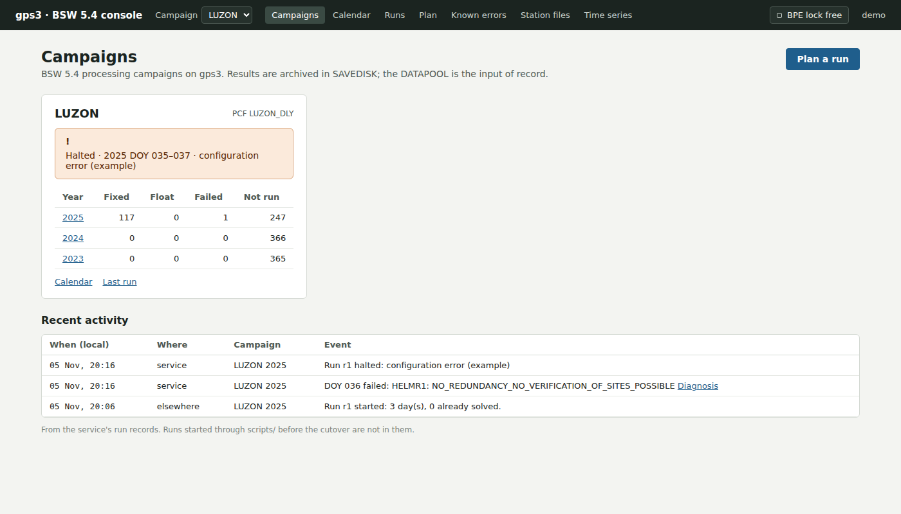

## 4. Data conversion (5.2 §4)

Unchanged. Convert with the Python scripts or the command line as the 5.2 work
instruction says, then give the daily RINEX files to the maintainer to put in
gps3's DATAPOOL.

Two things are tracked elsewhere. Antenna heights from paper log sheets are
what the field-ops logsheet app (`services/field-ops`) replaces. Converting on
Linux is not started (see section 8).

## 5. Bernese processing (5.2 §5), step by step

### 5.1 Installation

| 5.2 step | With the console |
|---|---|
| 5.1 Install BERN52, GPSUSER52, CAMPAIGN52, Perl, gzip, Hatanaka, FTPSSL | Nothing to install on your PC. BSW 5.4 is installed on gps3, and the maintainer looks after it |

### 5.2 Campaign setup

| 5.2 step | With the console |
|---|---|
| 5.2.1 Launch Bernese | Open the console (section 3) |
| 5.2.2 Edit list of campaigns | Not done by staff. Campaigns are set in the console's configuration (`BSW_CONSOLE_CAMPAIGNS`) by the maintainer. A new campaign is a maintainer task |
| 5.2.3 Select active campaign | Pick the campaign in the header. It is part of the page address, so two tabs can show two campaigns |
| 5.2.4 Create new campaign (NEWCAMP subfolders) | Not needed. The processing service builds each day's working campaign itself |
| 5.2.5 Session table | Not needed. Sessions are daily, and the service sets them |
| 5.2.6 Menu variables | Not needed. The Day page shows each day's date as YYYY MM DD, DOY and GPS week together |

### 5.3 Preparation of campaign files

The eight station files (STA, CRD, ABB, ATL, PLD, VEL, CLU, BLQ) still exist,
in gps3's DATAPOOL, and are still maintained by the maintainer. The console
shows them but does not edit them yet.

| 5.2 step | With the console |
|---|---|
| 5.3.1 Copy RINEX into `DATAPOOL\<campaign>` | The maintainer puts the files in gps3's DATAPOOL. **Plan** checks only the reference stations: a day with too few of them is left out, but it does not tell you whether a given station's RINEX is there. Ask the maintainer, and after the run check the stations in the solution on **Day** |
| 5.3.2 Set session | On **Plan**, choose the first and last day |
| 5.3.3 Copy RINEX from DATAPOOL to RAW | Don't. The service stages each day's files itself. On gps3, RAW is working space and may hold leftovers from earlier runs |
| 5.3.4–5.3.9 Create STA (RNX2STA), CRD and ABB (RXOBV3), ATL (GRDS1S2), PLD (EDITPLD), VEL (NUVELO), CLU (EDITCLU) | Maintainer task on gps3. Open **Station files** to see, for each station, which of the eight files list it and which don't, and codes that appear under two names |
| 5.3.10 BLQ from the Chalmers ocean-loading service | Still manual: the service is external and replies by email. The maintainer merges the reply with `scripts/merge_blq.py`. **Station files** lists stations missing from the BLQ, and counts anything after `$$ END TABLE` as missing |
| 5.3.11 Copy the eight files into `DATAPOOL\REF52` | Maintainer task. On gps3 the reference folder is `REF54` |

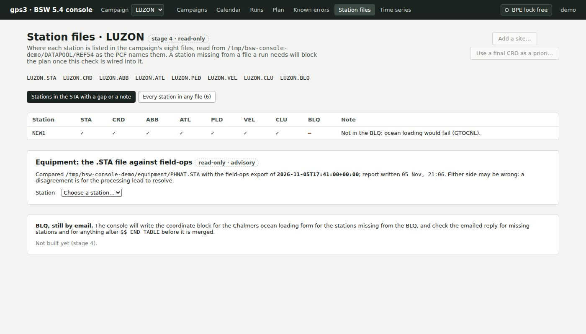

### 5.4 BPE setup

| 5.2 step | With the console |
|---|---|
| 5.4.1–5.4.2 Edit `PHIVOL_REL.PCF` variables (V_ATLINF, V_BLQINF, V_CRDINF, V_RNXDIR) | Not edited by staff. Each campaign has its own daily PCF (e.g. `LUZON_DLY`), derived and checked by the maintainer. **Plan** shows the PCF's steps |
| 5.4.3 RNXGRA thresholds: campaign 100/70/3, continuous 200/10/3 | **Plan** has an RNXGRA choice with the same two presets, for the record only: the preset in use is set in the RNXGRA panel, and the console doesn't change panels. **Start** refuses a plan that changes it. A run with the other preset is a maintainer task on the command line |

### 5.5 First BPE processing

Section 5.5 sets up a new campaign: first downloads, adding the IGS stations,
replacing the a priori coordinates. On gps3 all of it is a maintainer task.

| 5.2 step | With the console |
|---|---|
| 5.5.1 Run `FTP_DWLD` with every other script skipped | Not used. **Plan** checks the orbits, clocks, ERP, biases and ionosphere for the days that will run, and names the days missing each (the first ten). The maintainer fetches missing ones |
| 5.5.2 Run 001 R2S_COP to 099 DUMMY | Not done as a separate step. The service runs the whole daily PCF |
| 5.5.3 Update STA, CRD, ABB and CLU with the IGS stations | Maintainer task. Check the result on **Station files** |
| 5.5.4 Run the BPE to the last script | See 5.6.1 below |
| 5.5.4 note: Kill, then Reset CPU file | The console has no Kill button. **Stop after the current block** (operators) ends a run the console started, after the block of days in progress, and kills nothing. A run started from the command line is stopped there. A BPE that has to be killed is a maintainer task |
| 5.5.5 Check SAVEDISK outputs | Open the day on **Calendar**. The **Day** page lists the seven archived results with their 5.2 names, opens each in a viewer with search, and shows the stations in the solution, the stations dropped since the day before, and the HELMCHK RMS |
| 5.5.5 On error, open `$YSS+0_$PID_$SUBID.LOG` | **Why it failed**, on a failed day, opens the **Failure** page: the failed step (PID), script and program, the matching known-errors entry if there is one, and the log lines, with earlier attempts greyed out |
| 5.5.6 Replace the a priori CRD with the final one | Maintainer task. A "use as a priori" action is planned but not built |

### 5.6 Routine processing

#### 5.6.1 Daily BPE processing

This replaces 5.6.1.1 to 5.6.1.7.

1. Ask the maintainer to put new RINEX files in gps3's DATAPOOL (5.6.1.1).
2. Open **Campaigns**. Each campaign shows, per year, how many days are fixed,
   float, failed and not run, and its last run and that run's state.
3. Open **Calendar** for the campaign and year. Each day is coloured fixed,
   float, failed, running, queued or not run.

   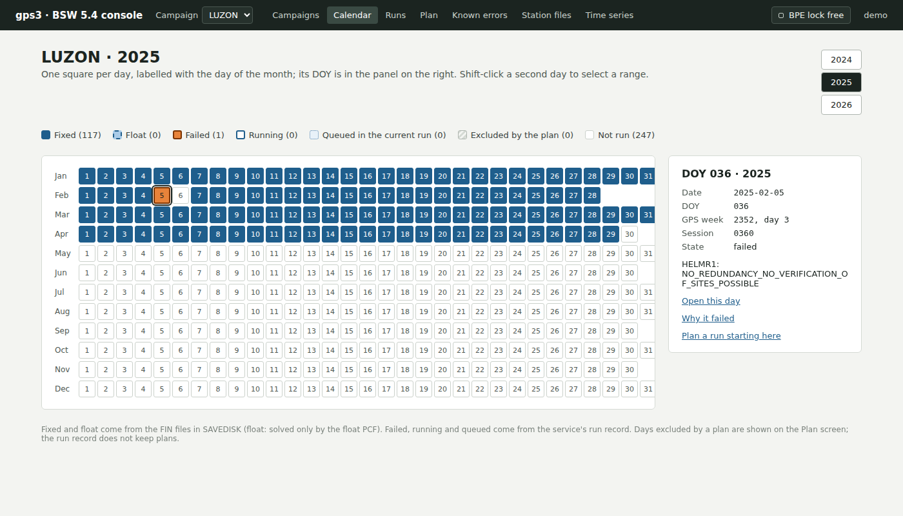

4. Open **Plan**. Choose the first and last day. The page checks the plan
   before anything runs:
   - which days will run, and which won't: too few reference stations, or
     already solved;
   - the products (orbits, clocks, ERP, biases, ionosphere), naming days that
     miss any;
   - the PCF steps, and whether the steps chosen leave any step waiting on one
     that won't run;
   - MAXPAR in each ADDNEQ2 option directory, beside the busiest day's station
     count. This is reported, not compared: a tick means the value was found,
     not that it is large enough.

   Fix or report anything it marks.

   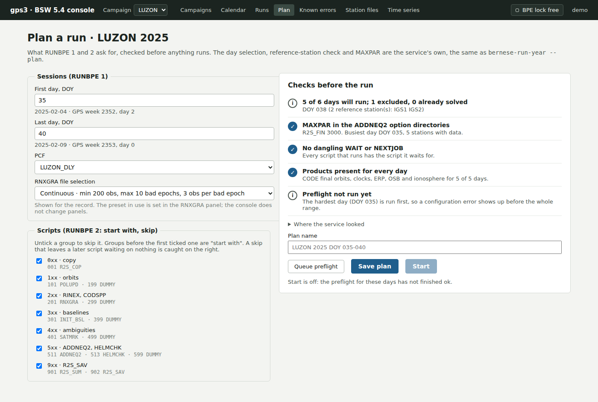

5. To run it, if you are an operator:
   - **Queue preflight** for the days. Start opens only after a preflight for
     exactly those days has finished OK in the last 7 days;
   - **Start**. The run worker on gps3 starts the run when the BPE lock is free.

   The console only runs the campaign's daily PCF whole. It refuses a plan that
   skips steps, changes RNXGRA or names another PCF. For those, or if you are not
   an operator, use **Save plan**, which writes the plan to a file the maintainer
   can read, and ask the maintainer to run it. `bernese-run-year` takes another
   PCF with `--pcf`, but has no option to skip steps or change RNXGRA, and it does
   not read a saved plan: the maintainer works out how to run those.
6. Follow the run on **Runs**: days down the side, PCF step groups across, each
   cell not started, running, done or failed. The running or failed step's PID
   is named. Stopping the whole run after repeated failures (the circuit
   breaker) is shown with its counters.

   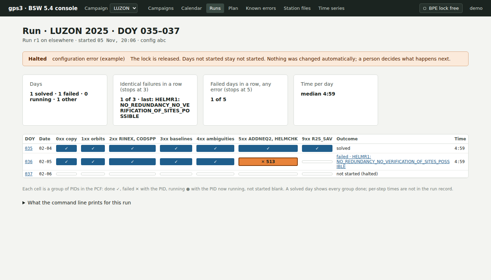

7. When it finishes, check a few days on **Day** (5.6.1.7): the stations in the
   solution, any drops, and the HELMCHK RMS.

   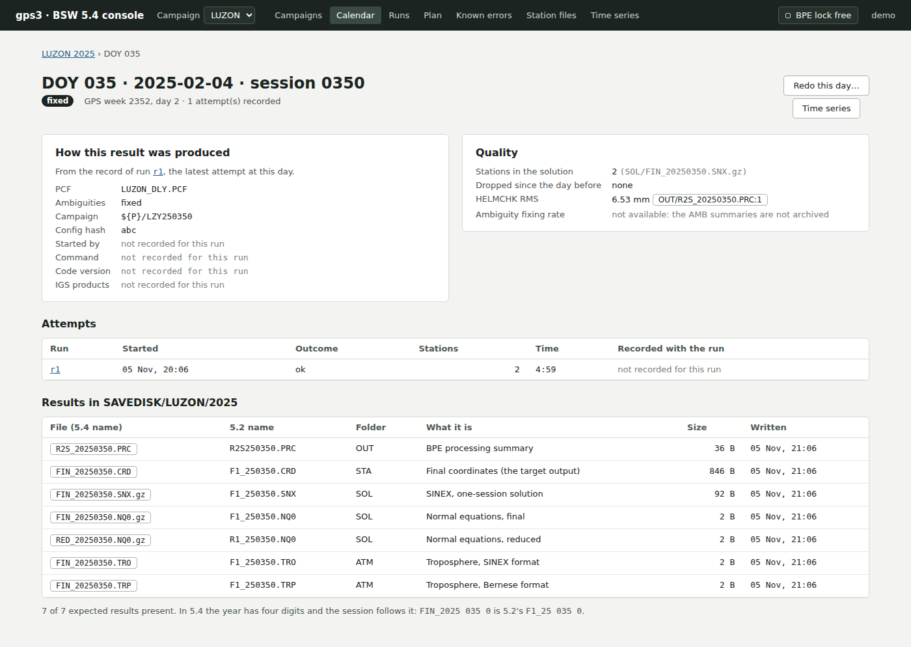

8. For each failed day, open **Failure**. If the error has a known-errors entry,
   follow its remedy. If not, report it to the maintainer with the day and the
   PID. **Known errors** lists every entry and how often it fired in the last 30
   days.

   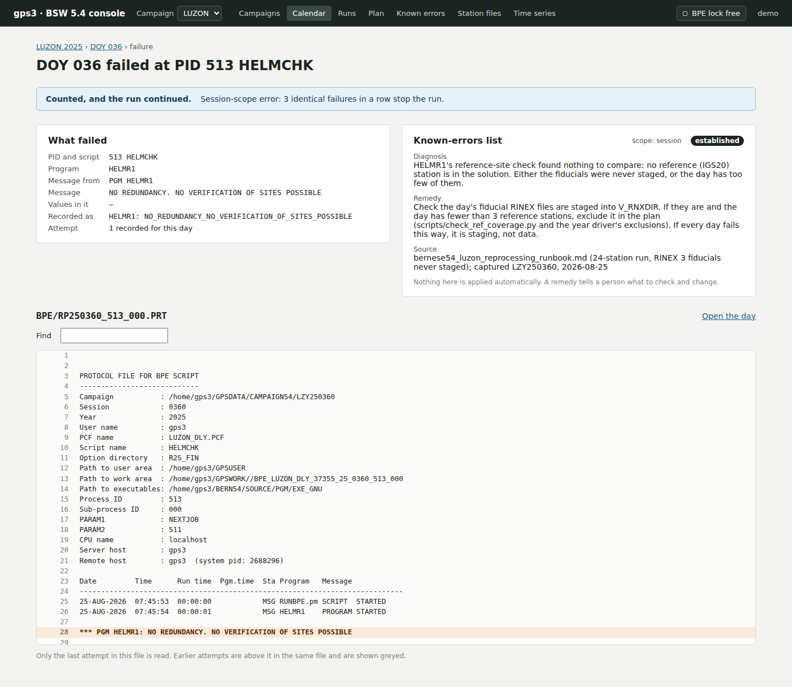

   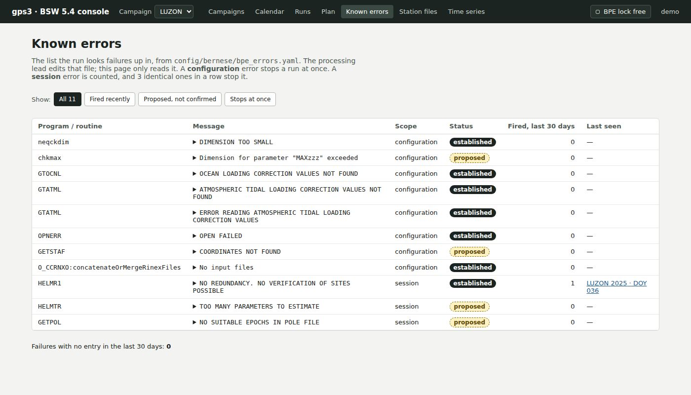

9. To run a day again, an operator uses **Redo this day** on its **Day** page,
   not deletion.
   In 5.2, a day is redone by deleting its F1 files. On 5.4 that replaces only 2
   of the day's 7 results, and later steps pick up the old ones by name. Redo
   lists every file that will move aside, needs a reason and the DOY typed in,
   and moves the files only when the job starts. If the redo fails, they come
   back.

   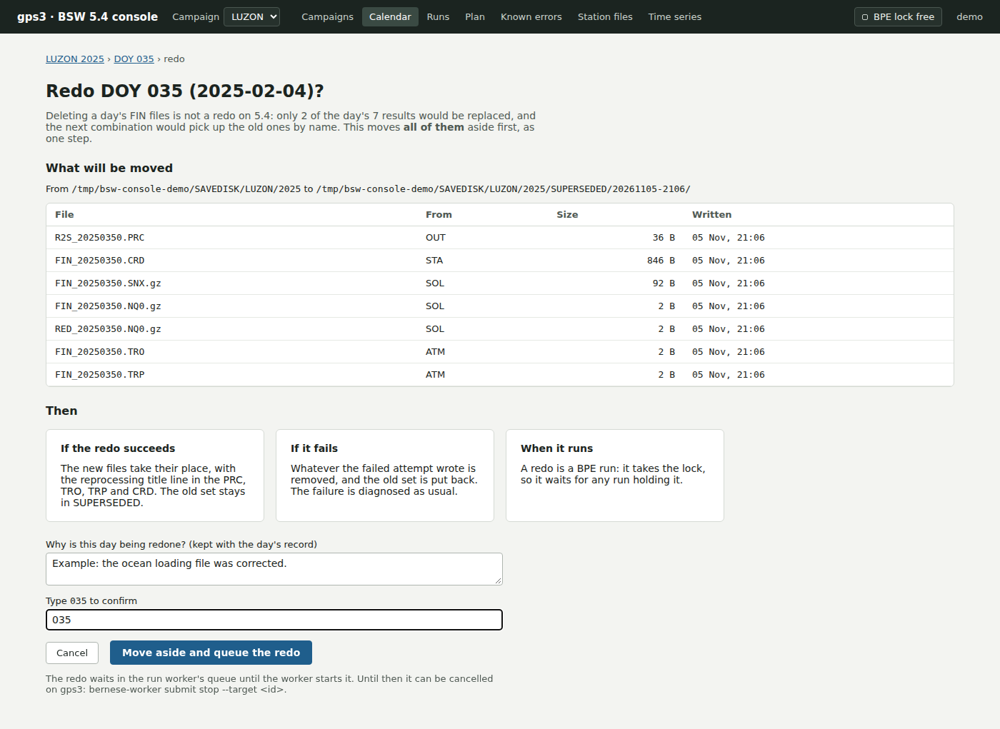

#### 5.6.2 Updating station information

Equipment changes are still entered in the STA file by the maintainer, with the
same rule as 5.2: a new line after the old one, with start and end dates,
spaces not tabs. On **Station files**, the equipment panel shows one station's
entries from the latest equipment report (`bernese-check-equipment`), which
compares the STA file with the field logsheets. The disagreement below is made up
for the test data, including the station it is shown on.

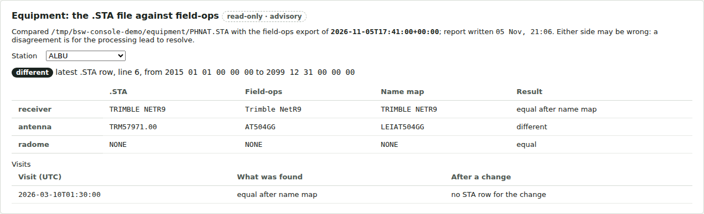

#### 5.6.3 Adding a new site, 5.6.4 Adding an IGS reference site

Maintainer task, following the 5.2 steps on gps3. Afterwards, **Station files**
shows whether the new station is in all eight files. A guided "add a site" in
the console is planned but not built.

#### 5.6.5 Updating the GEN folder

Maintainer task. It can't follow 5.2 as written, because the AIUB FTP server is
blocked from gps3. Not in the console. A nightly job compares these files with AIUB's
and tells the maintainer what differs. It doesn't replace them, because updating one
changes results for days already solved.

### 5.7 Manual download of external inputs

Maintainer task. gps3 uses CODE products (orbits, clocks, ERP and biases, all
from the one analysis centre) from a mirror of the AIUB data, through
`scripts/fetch_igs_products.sh` and a nightly job, instead of the CDDIS and AIUB FTP
downloads in 5.7.1. **Plan** shows which days are missing products.

The IGS reference stations are set per campaign. The 5.2 work instruction lists
twelve (5.7.2.3). The LUZON campaign uses nine, and only seven of them are on
both lists (`docs/bern52/workflow_automation_inventory.md`, Inventory E). Check
which list a campaign uses with the maintainer.

## 6. Time series (5.2 §6)

The console's **Time series** page runs the project's Python port of the
velocity computation, `pogf_geodetic_suite.timeseries`. It reproduces the
MATLAB results of `vel_line_v8_newvelduetooffset_v4.m`, the variant of
`vel_line_v8.m` held in this repository, to better than 5e-6 mm/yr on 161 of 165
velocity components (`docs/SETTLED.md` §2).

**It reads every year of the campaign as one series**, so a velocity comes from
the station's whole history in that campaign, as in 5.2. The buttons above the plot
jump to one calendar year; the velocities stay those of the whole series. A final
segment under the one-year minimum shows crossed out.

| 5.2 step | With the console |
|---|---|
| 6.1 Install Python and MATLAB; download the scripts and `offsets` from Google Drive | Nothing to install. The `offsets` catalogue is in this repository (`docs/bern52/phivolcs-scripts/event-catalog/offsets`). The page shows the catalogue's path and its sha256, so you can tell which version a result used |
| 6.2.1–6.2.3 Copy `F1_*.CRD` files, run `filter-fncrd.bat` | Not needed. The page reads the daily final CRDs from the `STA` folder of the campaign's result folder for each year, and uses only the stations each solution estimated |
| 6.2.4 `plot_v2.py`; enter the reference station (S01R) | Choose the **Reference station** on the map of the stations or in the list. Both hold every estimated station in the CRD files. On the map, press **Reference**, then click a station; a dashed ring shows the 5 degrees past which the page warns, and hovering over a station gives its distance. **Any campaign can start from any estimated station.** gps3 sets no default, so you choose one; where a default is configured, as in the demo screenshot below, the list marks it "(default)". S01R isn't required: 5.2 uses it by tradition, from the collaboration with Taiwan (IES-AS and NCKU), and 6.2.4.2 itself says the choice is not fixed. Changing it refits every station. As in 5.2, the reference's position is read from each day's own file, so its motion is subtracted, and a day without it gives no epoch for any station. **So the reference decides what a velocity is relative to.** 6.2.4.2 uses S01R for velocities relative to the Eurasian Plate; with a station in the Philippines they are relative to that station's own motion, so say which reference you used, and don't compare them directly with velocities against S01R. **For the axes, pick a nearby station.** East, North and Up are the reference's axes, so a far-away one, such as an IGS station, rotates a station's motion between them: for ALAB, about 0.4 mm/yr with PIMO, 1.1 degrees away, and up to 7.7 mm/yr with AIRA, 19.4 degrees away. The page always shows the distance, and warns above the plot when it is over 5 degrees. The numbers are not changed. **With S01R, expect this warning on nearly every station** (section 9, question 1, has the counts). It comes from the distance: East, North and Up are tilted the same way as in 5.2's own plots. It does not mean the run has a problem, and the velocities are computed from those axes as in 5.2. Check the campaign estimates S01R too: LUZON does only from January 2026, so with S01R its series starts there, and the page says how many days the reference is missing from |
| 6.2.5–6.2.6 Check the `123` file and the `offsets` file | Click a **Station** on the map, or choose it from the list. The page shows the offsets that apply to it, and whether each falls inside the series. **The catalogue on gps3 is the campaign snapshot in this repository, and the continuous stations' catalogue has not been copied (section 8).** A continuous station can show no offsets because they are missing, and its velocity is then fitted straight across any real step. Check those against your own list |
| 6.2.7 Run `vel_line_v8.m` | Shown for the station chosen. A plot of East, North and Up on one time axis replaces the JPG: epochs in the fit as dots, epochs the outlier rule flagged in orange, epochs left out of the fit for any other reason hollow, the fitted line for each segment, and the catalogue's offsets as dashed lines. Ctrl with the mouse wheel zooms, Shift with the wheel pans, dragging selects a span, and a double-click shows everything. Below it: the velocity of the final segment with its 1-sigma, East, North and Up, and the span it covers, with a note when the newest epochs are too few to fit, so the rate is the one before the latest event; then, for each segment between offsets, its start and end as decimal years, epochs, epochs in the fit, outliers and velocities. A final segment shorter than the minimum span (one year) is crossed out, because a rate from too little data means nothing |
| 6.2 note: horizontal only, usually | Unchanged. The page shows Up as well; read it with the same care |
| 6.3 Outlier removal: `outlier_input-site.py`, right-click, hand-edit PLOT files, re-run MATLAB | Click an epoch on the plot; a drag doesn't pick one. A small popup opens beside the point, with the rule's flag and any decision so far. A flagged epoch offers **Confirm outlier**, or **Keep it: not an outlier** with a reason. An unflagged one offers **Mark as outlier** with a reason. **Undo decision** takes a decision back. Recording closes the popup, so you can go straight to the next epoch; Escape, the close button or a click elsewhere closes it too. Each decision is kept with your name, the reference station and a hash of the day's CRD files, and no file is edited. Rings mark decided epochs. A dashed line and a row marked "not published" show the fit without the confirmed outliers. A decision made against another reference station, or on a day since reprocessed, is shown as such and not applied. The page's outlier mode stays `record`: flagged epochs are reported and kept in the fit. Decisions don't reach PLOT files or production plots; for those, keep using `tools/velocity-reviewer` |

The map opens on the stations near the middle of the network. The dashed ring is 5 degrees around
the reference, and stations outside it are orange. **All stations** also brings in
the far ones.

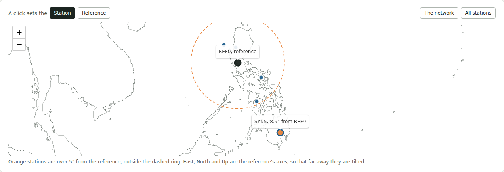

With a far reference, nearly every station is orange and the warning appears above
the plot:

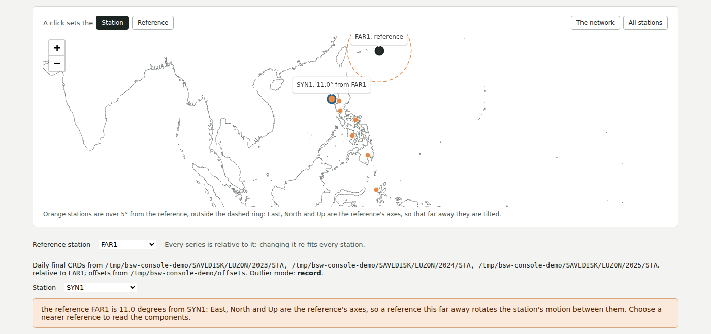

The page after a flagged epoch was confirmed: the ring on the plot, a line saying what was recorded, and a velocity row marked "not published" beside the one that counts.

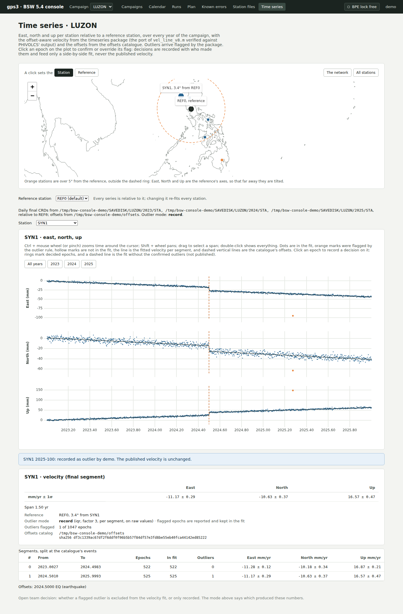

The popup on a flagged epoch, before anything is recorded:

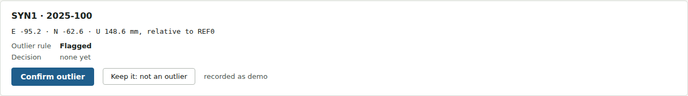

Whether a confirmed outlier is left out of the published fit is an open team
decision (`docs/SETTLED.md` §6). The page names the mode it used so the numbers
can be read either way.

For a velocity map, the maintainer runs `scripts/make_velocity_field.py`, which
writes GMT `psvelo` input. It is not in the console.

## 7. What the console does not do yet

| | Where it stands |
|---|---|
| Listing queued requests | Not built. A queued request can be cancelled only on gps3 |
| Start with skipped steps, another RNXGRA or another PCF | Refused on purpose: the console runs the PCF whole. These stay on the command line |
| Editing station files, adding a site, "use as a priori", checking a BLQ reply | Planned (console stage 4). **Station files** is read-only today |
| GEN folder age against AIUB's | Not in the console. A nightly job emails the maintainer what differs (5.6.5) |
| Confirmed outliers leaving the published fit | Waiting on the team's decision (section 9, question 2). Today they change only the side-by-side fit |
| Ambiguity fixing rate on the Day page | Not available: the AMB summaries are not archived |
| Days left out of a run on purpose | Never shown as "excluded", because the run record does not keep plans |

## 8. Automation gaps beyond the console

The console is one part of a longer effort to remove manual steps from the
three tasks in the 5.2 work instruction. That effort is tracked in two
documents, both written by going through the 5.2 work instruction step by
step:

- `docs/project_documentation/automation_stages.md`: the three stages (§4, §5,
  §6), how far each is automated, and what is worth automating. Its working
  rule is decision support, not autonomy: the system finds, ranks and
  highlights, and a person decides.
- `docs/bern52/workflow_automation_inventory.md`: every program, script and
  external source the 5.2 work instruction uses, and its status on gps3.

What they list as still open, in short:

| Task | Open |
|---|---|
| §4 Raw data to RINEX | Not started. It waits on getting field metadata (antenna type and height) into a machine-readable form, which the field-ops logsheet app does. It also needs the Linux `runpkr00` tested on a real Trimble file, and a decision on reading Leica raw data. `teqc` can't read RINEX 3 |
| §5 Bernese processing | Largely automated: production runs through the processing service since 4 November 2026. Open: explaining why the reprocessed PHREF 2025 coordinates differ from the ones they replaced (median 0.02 mm, maximum 40.5 mm a day), and whether any velocity moved. No solution is written to the database yet |
| §6 Time series | The velocity computation is ported and checked against the MATLAB output. Open: outlier detection on residuals from the fit instead of raw values; detecting offsets that are not in the catalogue yet, which needs a different statistic from IQR; one place to keep processed data and plots; a before-and-after view at each offset; a copy of the continuous stations' offsets catalogue. Production plotting still runs `RUNX_v2.py` |

The scripts in Google Drive's `03 Scripts` folder are not all in this
repository yet (`compute_ant-h.xlsx`, `filter-fncrd.bat`, `plot_v2.py`,
`vel_line_v8.m`, `outlier_input-site.py`). The inventory lists that as the first
thing to fix: losing them would lose the procedure.

## 9. Questions for the processing team

1. Is 5 degrees the right distance for the page to warn at? Against PIMO it warns
   for 21 of PHREF's 42 stations, and S01R is itself 9.1 degrees from PIMO.
   Against S01R (2026-11-05) it warns for all 42 other stations in PHREF, for 89
   of the other 92 in PHDEN, and for 25 of the other 31 in LUZON, so an operator
   following 5.2 would see it nearly every time. The stations it does not warn
   for: BASC and TNML in PHDEN are inside 5 degrees, and PHDEN's LABO has too few
   epochs to fit. LUZON's other six (BALA, BASC, CLAV, INFA, PTBN, TANY) show no
   series, because LUZON estimates S01R on only 31 of its 388 days, all in January
   2026, and those six have no day in common with it. So in LUZON, S01R gives one
   month, under the one-year minimum, which is one reason to choose another
   station there. No single reference is required, which is settled: any campaign
   can start from any estimated station.
2. Should a confirmed outlier be left out of the fit, or kept and recorded?
   (`docs/SETTLED.md` §6.)
3. Which IGS reference stations should each campaign use (5.7.2.3 against the
   LUZON list)?
4. Start, Stop and Redo are limited to the maintainer's list of operators. Is the
   list right?
5. Is anything you do in the 5.2 menu missing from this document?
